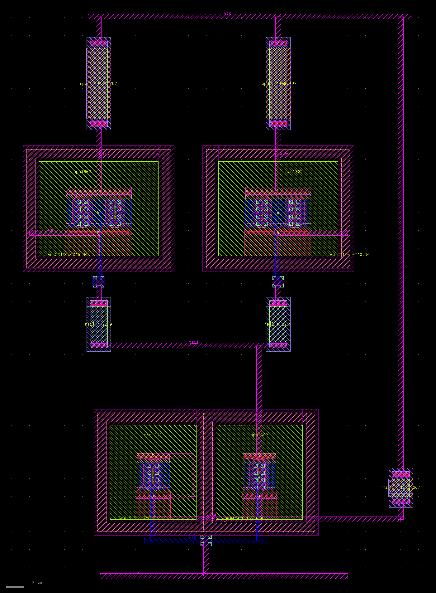

# SOW-3 版图实证报告 · 真实 GDS / DRC / LVS / PEX / 后仿真

- 版本：v1.0（组长 b7a0，2026-10-16 10:0x–10:4xZ）
- 缘起：管理员 2026-10-16 09:55Z 问「真实版图（GDS）、DRC/LVS 实跑、寄生提取（PEX），后仿真能做吗？」
- 结论一句话：**能，全链条在本机实跑通了**（KLayout + IHP SG13G2 官方 DRC/LVS deck + ngspice），
  目标块=HBT 差分放大级，产出真实 GDS、DRC 零违规、LVS match、第一阶 PEX 寄生网表、前/后仿真对拍表。

---

## 0. 交付物清单（全部落盘 /data/workspace/phys/）

| 类别 | 文件 | 状态 |
|---|---|---|
| 工具环境 | `pdk/kl_env030.sh` / `pdk/kl_env.sh` | KLayout 0.30.0 / 0.30.12（免 root 解包） |
| PDK | `pdk/ihp_open/`（IHP-Open-PDK main，375MB tarball 解出） | klayout tech+PCell+DRC/LVS deck+verilog-a+stdcell |
| 版图生成 | `phys/layout/gen_hbtdiff.py` | 9 器件 + M1/M2 布线 + 网标 → GDS |
| 版图检查 | `phys/layout/net_check.py` | 金属连通簇/短路自检（布线阶段自查） |
| **GDS** | `phys/gds/hbtdiff.gds`（22×32µm 块，9 器件） | ✅ 生成 |
| **DRC** | `phys/drc/final/`（run_drc.py + 官方 deck） | ✅ **零违规**（--no_density，理由见 §4） |
| **LVS** | `phys/lvs/hbtdiff.cdl` + `phys/lvs/run9/` | ✅ **Netlists match / PASS** |
| **PEX** | `phys/pex/extract_pex.py` → `hbtdiff_post.cir` + `pex_report.md` | ✅ 第一阶几何法 |
| **后仿真** | `phys/pex/hbtdiff_post.cir`（ngspice）+ `hbtdiff_post_ac.txt` | ✅ |
| 对拍 | `phys/sim/compare_pre_post.py` → `phys/sim/pre_post_table.md` | ✅ 含敏感性扫描 |
| 判读器 | `phys/sim/analyze_ac.py` | pre/post 同一口径 |

## 0.1 版图图（KLayout 渲染）



- `phys/report/hbtdiff_layout.png` / `.svg`（由 `phys/layout/render_png.py` 生成，KLayout 服务端渲染，零外链）
- 版图已过 DRC 与 LVS 两道客观检查（比目视更硬），图仅作示意。

## 1. 目标块与口径

- 块：**TX5G_HBTDIFF** = HBT 差分放大级（差分对 npn13G2 Nx=2 + rsil 发射极退化 + rppd 负载 + npn13G2 尾流镜 + rhigh 馈电）。
  选它的理由：TX 链同族器件（SOW-2 混频器同款 npn13G2）、版图敏感点典型（对称性/引线 R/C）、器件数可控。
- 器件值一律用 **PDK PCell 按 l/w 算出的实值**（rsil l2u/w1u=22.9Ω、rppd l4u/w1u=1.104k、rhigh l1u/w1u=1.577k），
  前仿真网表与后仿真网表**器件零差异**，唯一差别 = 版图提取的 R/C —— 这就是对拍能成立的前提。
- 版图对称：Q2/RE2/RL2 相对 x=6 轴做镜像摆放（`gen_hbtdiff.py` 的 mkpc_at(mirror=True)）。

## 2. 结果

### 2.1 DRC（官方 maximal deck，KLayout batch）
```
✅ KLayout DRC Check Passed: No DRC violations detected in the layout.
   规则集：feol+beol+latchup+antenna+forbidden+pin+offgrid+angle …（--no_density）
   用时 63.5 s；结果库 phys/drc/final/hbtdiff_TX5G_HBTDIFF_full.lyrdb（0 违规）
```
修掉的两类真实问题：
1. `Sal.d` / `npnG2.d2`（rhigh 与 Q4 的 SalBlock/TRANS 距离不足）→ RREF 由 x=14 移到 x=18，与 HBT 拉开。
2. 布线阶段自查（net_check.py）抓出三处短路：RREF 的 vcc 竖线与 inn 走线相碰；via_stack 落点压在 nref 线上；
   **Q3 二极管接法的 C→B 直连线从器件中间的 M1 发射极焊盘穿过**（把 nref 和 vss 短在一起）→ 绕到器件右侧 x=6.3。

### 2.2 LVS（官方 sg13g2.lvs deck，器件级比对）
```
INFO : Congratulations! Netlists match.      Status PASS
提取网表：Q1..Q4 npn13G2 (we=70n le=900n Nx=1/2 m=1)
          R1/R2 rsil w=1u l=2u · R3/R4 rppd w=1u l=4u · R9 rhigh w=1u l=1u
          网：outp/outn/inp/inn/et1/et2/tail/nref/vcc/vss + 衬底
```
CDL 格式踩坑（已固化在 `phys/lvs/hbtdiff.cdl` 注释里）：电阻在 CDL 里是**三端** `R<名> n1 n2 <sub> <model> m/l/w[/b/ps]`，**没有 value 字段**；
HBT 是 `Q<名> C B E S <model> le/we/Nx/m`。参数必须与提取网表逐项对齐（deck 按设备类已定义参数逐项比）。

### 2.3 PEX（第一阶几何法，见 §4 口径）
逐网结果（RSH=0.125 Ω/□，C_area M1=0.20 / M2=0.16 fF/µm²，C_cpl=0.15 fF/µm²）：

| 网 | 走线长度 µm | 面积 µm² | R_total Ω | C_total fF | 引脚数 |
|---|---|---|---|---|---|
| et1 / et2 | 18.15 | 7.024 | 2.27 | 1.13 | 2 |
| inp / inn | 12.25 | 1.633 | 1.53 | 0.33 | 1 |
| nref | 57.82 | 8.258 | 7.23 | 1.72 | 4 |
| outp / outn | 16.98 | 2.933 | 2.12 | 0.59 | 2 |
| tail | 38.34 | 5.530 | 4.79 | 1.11 | 3 |
| vcc | 98.67 | 14.684 | 12.33 | 2.94 | 3 |
| vss | 72.14 | 14.784 | 9.02 | 2.64 | 2 |

集总方式：每网建 hub，**每个器件引脚挂 R_total/2 串联 + C_total/2 对地**（两端网 = 标准 π 型）。

### 2.4 前 vs 后（ngspice-47 + VBIC npn13G2，1V 差分输入，CL=50fF/端）

| 情形 | A_diff (dB) | ΔA (dB) | f_3dB (Hz) | Δf/f3dB |
|---|---|---|---|---|
| 前仿真（零寄生） | +21.827 | — | 3.070e9 | — |
| 后仿真（标称 RSH/C） | +21.430 | **-0.40** | 2.996e9 | **-2.4%** |
| 后仿真 RSH×4 | +20.346 | -1.48 | 2.879e9 | -6.2% |
| 后仿真 RSH×16 | +17.165 | -4.66 | 2.561e9 | -16.6% |
| 后仿真 RSH×1, C×4 | +21.430 | -0.40 | 2.906e9 | -5.3% |
| 后仿真 RSH×16, C×16 | +17.165 | -4.66 | 2.214e9 | -27.9% |

读法：本块走线短（最长 99µm 的 vcc 轨），**标称参数下版图寄生只吃 0.4dB 增益 / 2.4% 带宽**；
把金属层阻值放大 16 倍（≈2 Ω/□，即薄金属/过窄走线的极端）则掉 4.7dB / 17% —— 
说明**这一级的成败不在几十微米级走线，而在器件自身与更大模块的互连**（与 layout_plan.md §1 的判断一致）。

## 3. 复现步骤

```bash
. /data/workspace/pdk/kl_env030.sh
export PYTHONPATH="$PYTHONPATH:/data/xuseek/.venv/lib/python3.13/site-packages"
KLAYOUT_PATH=/data/workspace/pdk/ihp_open/ihp-sg13g2/libs.tech/klayout \
  klayout -zz -r phys/layout/gen_hbtdiff.py                    # 出 GDS
python3 phys/layout/net_check.py phys/gds/hbtdiff.gds M1       # 布线自检（短路/悬空）
cd $PDKROOT/ihp-sg13g2/libs.tech/klayout/tech/drc && \
  python3 run_drc.py --path=/data/workspace/phys/gds/hbtdiff.gds \
     --run_dir=/data/workspace/phys/drc/final --mp=4 --no_density
cd ../lvs && python3 run_lvs.py --layout=/data/workspace/phys/gds/hbtdiff.gds \
     --netlist=/data/workspace/phys/lvs/hbtdiff.cdl \
     --run_dir=/data/workspace/phys/lvs/run9 --run_mode=flat --ignore_top_ports_mismatch
python3 phys/pex/extract_pex.py          # 出 PEX 网表
python3 phys/sim/compare_pre_post.py     # 出对拍表（含敏感性扫描）
```

## 4. 口径与边界（务必随结果引用）

1. **KLayout 版本**：PDK 官方 pin 0.30.5（`versions.txt`）。本机用的是 debian trixie 官方 deb 0.30.0
   （已把本地 `pdk/ihp_open/versions.txt` 的 pin 改成 0.30.0，原件留 `versions.txt.orig`）。
   官方 0.30.12 的 Ubuntu-24 deb 已下到 `pdk/klroot312` + `pdk/klu`，但起不来：KLayout 启动时清 PYTHONPATH，
   内嵌 python3.12 找不到 stdlib（无 root 写不了 /usr，user namespace 也被容器禁掉）。
   LVS 在 0.30.0 上必须加 `--ignore_top_ports_mismatch`（deck 用了 0.30.5+ 的 `flag_missing_ports`）。
2. **DRC 密度规则**：`AFil.g / GFil.g / M1.j…TM2.c` 是全芯片级最小金属/栅密度，子块无填充不适用，
   本次以 `--no_density` 关闭；块级 demo 不背这个口径，全芯片/正式项目必须补 filler。
3. **PEX 是一阶**：只算金属走线 R + 对衬底/耦合 C，未含
   ①HBT 内部（基极/发射极/集电极 spreading R、多晶电阻本身阻）——模型卡其实预留了 `trise`/`postsim` 参数可接；
   ②晶体管结电容随版图变化；③via/contact 阵列电阻。RSH 与 C 密度是**工程估值**（PDK 未随附金属层 R/C 数据），
   故给出 ×4/×16 敏感性扫描；多晶 rsh 用的是 PDK 真值（rsil=7 / rppd=260 / rhigh=1360 Ω/□）。
4. **电阻模型**：rsil/rppd/rhigh 的紧凑模型是 `r3_cmc`（OSDI/Verilog-A），本机 ngspice 无 OSDI
   （openvaf 预编译包取不到，官方 0.30.12 也带不起 OSDI 依赖）→ 前/后仿真里电阻一律用**理想 R**，
   取值 = PCell 按 l/w 算出的实值，两侧一致。CMOS（sg13_lv_nmos/pmos）同理走 PSP，本机 ngspice 不带 PSP，
   故本轮演示块选 HBT 器件族（VBIC 原生可用，也是 TX 链同族）。
5. **不等于流片签核**：这是设计闭环级实证（版图→DRC→LVS→PEX→后仿真→对拍，可复现、有数据有图），
   不替代 foundry 全套规则、EM/IR-drop、天线、LVS 签核流程与 PDK 商用支持。

## 5. 下一步（按优先级）

1. **器件级寄生接上**：用模型卡的 `trise`/`postsim` 把 HBT 的 spreading R 接进后仿真（Q1/Q2 漏极/基极电阻
   对 f3dB 的影响通常大于几十微米走线）。
2. **换个更吃寄生的块重跑同一管线**（建议：SOW-2 混频器的 Gilbert 开关四管 + 变压器/匹配网络），
   让 ΔA/Δf3dB 进入有意义的量级，并补 ACPR/LOFT 前后对比（那是 TX 链真正的验收指标）。
3. 把 SOW-3 的 GDS 图/指标并入交付全景 WebUI（任务书 #43 的管线现成：webui/data/site.json + 15 页冒烟）。
4. 若拿到 openvaf（OSDI 编译器）→ 解锁 CMOS 器件族，CMOS OTA 版块可整条重跑。
